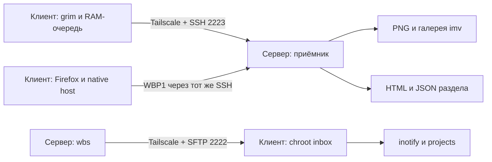

# Waybridge

**Скриншоты, файлы и разделы страниц между двумя Linux-компьютерами через Tailscale.**

[Релиз 3.6.6](https://github.com/Archibald-42/waybridge/releases/tag/v3.6.7) · [Проверки CI](https://github.com/Archibald-42/waybridge/actions/workflows/tests.yml) · [Экспорт форм](docs/PAGE-EXPORT.md) · [Настройка Hyprland](docs/HYPRLAND.md) · [Безопасность](SECURITY.md)

Ноутбук — **клиент**, второй компьютер — **сервер**. Интернет может быть мобильным: публичный IP, IPv6 и проброс портов не нужны. Устройства связываются по Tailscale IPv4, данные передаются через SSH с закреплённым ключом второго устройства.

## Что умеет

| Функция | Как работает |
| --- | --- |
| Снимки клиент → сервер | `grim` снимает активный монитор; RAM-очередь отправляет PNG, галерея `imv-wayland` показывает его на сервере. |
| Несколько снимков подряд | До 8 заявок и 64 МиБ в очереди, последовательная отправка и подтверждение каждого снимка. |
| Файлы сервер → клиент | `wbs main.py input.txt` отправляет файлы через ограниченный SFTP; они появляются в `~/Documents/projects` под исходными именами. |
| Экспорт текущего раздела формы | Nordic Reader для Firefox передаёт текст, порядок вариантов, состояние полей и полный визуальный снимок доступного раздела. На сервере создаётся автономный HTML. |
| Восстановление после сбоя | Повторная доставка с тем же ID, проверки SHA-256, атомарное сохранение, перезапуск обработчиков и галереи. |
| Сохранность локальных правок | Перезапуск обработчика не копирует уже обработанный inbox поверх правок в projects. Новая загрузка сохраняет прежнее содержимое в versions. |
| Управление | На клиенте Win+X — запуск, Win+A — снимок, Win+Z — остановка. CLI доступен на обоих устройствах. |
| Индикация | Процент батареи настоящий; оттенок показывает готовность связи. Часы показывают обычное системное время. |
| Два формата Hyprland | Автоопределение `hyprland.lua` или `hyprland.conf`; явный выбор для нестандартной конфигурации. |

Перехват клавиатуры, автоматический ввод кода, виртуальная клавиатура, текстовые оверлеи и замена часов в базовом приложении отсутствуют.

## Куда сохраняются данные

**На сервере:**

| Данные | Путь по умолчанию | Формат и хранение |
| --- | --- | --- |
| Отправленные скриншоты монитора | `~/.cache/bridge/shots/` | `<ID>.png`, последние **50** снимков. Можно открыть напрямую или через галерею. |
| Экспортированные формы/разделы страниц | `~/.cache/bridge/pages/` | `<ID>.html` для чтения и `<ID>.json` с данными и PNG-фрагментами; последние **10** экспортов. |
| Указатель на последнюю форму | `~/.cache/bridge/pages/latest.json` | Содержит ID последнего принятого экспорта. |

Изображения внутри экспорта формы встроены в HTML и JSON; отдельные PNG в папке `shots` относятся к снимкам монитора. HTML открывается без сети и не исполняет скрипты исходной формы. Приёмник подтверждает сохранение, а автоматическое открытие HTML выполняется отдельно через `xdg-open`.

**На клиенте:**

| Данные | Путь по умолчанию |
| --- | --- |
| Полученные файлы | `~/Documents/projects/` |
| Входящая SFTP-папка | `/srv/bridge/inbox/` |
| Предыдущие версии перезаписанных файлов | `~/.cache/bridge/versions/` |
| Настройки пары | `~/.config/waybridge/config.toml` |

Пути внутри `~/.cache/bridge` вычисляются относительно параметра `state` в конфигурации **соответствующего устройства**; при его изменении таблицы выше нужно читать с новым корнем. Скриншоты на клиенте идут через RAM, без локального PNG-файла и буфера обмена. Очереди RAM не переживают остановку, завершение процесса и выключение питания. Содержимое серверного cache может удалить системный или пользовательский очиститель; важные файлы скопируйте в постоянную папку.

При удалении Waybridge входящие файлы, снимки, экспорты страниц и история версий архивируются в `~/.local/state/waybridge-preserved/ВРЕМЯ` на каждом устройстве. `~/Documents/projects` сохраняется. Удаление расширения Firefox выполняется отдельно в менеджере дополнений.

## Быстрая установка

Нужны **Arch/CachyOS, Hyprland с `.conf` или `.lua`, Python 3.11+, systemd** и Tailscale на обоих устройствах. Для показа изображений на сервере нужна запущенная графическая Wayland-сессия. Автоматический вход через SDDM установщик не настраивает.

На **обоих** компьютерах в обычном терминале графической сессии:

```bash
git clone --branch v3.6.7 --depth 1 https://github.com/Archibald-42/waybridge.git
cd waybridge
bash setup.sh
```

Для приватного репозитория нужен доступ GitHub: например, `gh auth login` и `gh auth setup-git`. Можно также скачать и распаковать исходный архив релиза, затем выполнить `bash setup.sh` из его папки.

Мастер сам устанавливает зависимости, создаёт локальные ключи, настраивает ограниченные SSH endpoints, firewall, пользовательские службы и интеграцию с рабочим столом. Не запускайте весь мастер от root: sudo вызывается для системных шагов.

1. Выберите **client** на ноутбуке и **server** на втором ПК.
2. Передайте созданный публичный `.wbpair` другому устройству через предложенный Taildrop. Приватные ключи остаются на своём компьютере.
3. Выберите профиль другого устройства и сверьте код пары.
4. Введите пароль sudo для системной настройки. Повторите на другом устройстве.
5. Выполните `waybridge check` на обоих компьютерах.

Если профиль второго устройства ещё не готов, выберите `q`: свой профиль сохранится в `~/Downloads/`. После обмена повторите мастер. Если команда `waybridge` не появилась в уже открытом терминале, откройте новый или используйте `~/.local/bin/waybridge`.

### Новый сервер с hyprland.conf

Если существует только `~/.config/hypr/hyprland.conf`, формат выбирается автоматически. Установщик добавит одну строку `source` для своего серверного модуля, который запускает транспорт при входе в Hyprland. Пользовательские настройки остаются на месте, перед изменением создаётся резервная копия.

Если существуют оба формата или используется нестандартный файл, укажите активный явно:

```bash
bash setup.sh --role server --hypr-config ~/.config/hypr/hyprland.conf
```

Выбранный путь запоминается и используется при обновлениях. Симлинк на dotfiles сохраняется: изменяется его целевой файл с резервной копией. Подробности, смена формата и ручное подключение — в [docs/HYPRLAND.md](docs/HYPRLAND.md).

### Зависимости

| Устройство | Пакеты |
| --- | --- |
| Обоим | `python tailscale openssh nftables inotify-tools` |
| Клиенту | `acl grim waybar` |
| Серверу | `imv xdg-utils` |

Python-пакетов из PyPI нет. Bootstrap создаёт venv без pip и атомарно переключает установленную копию исходников. Для работы не нужны `ydotool`, `/dev/uinput` или доступ к устройствам клавиатуры.

## Повседневное использование

| На клиенте | Действие |
| --- | --- |
| Win+X | Запустить транспорт |
| Win+A | Отправить снимок активного монитора |
| Win+Z | Остановить обработчики, очередь и SFTP |

Используются физические коды Z/X/A; раскладка не меняет расположение сочетаний. Закрытие галереи на сервере не останавливает приёмник: следующий снимок снова откроет окно.

```bash
waybridge start
waybridge stop
waybridge restart
waybridge status
waybridge check
waybridge shot status
```

На сервере:

```bash
wbs ~/Documents/main.py
wbs main.py input.txt config.json
wb-send-as other.py main.py
wb-files
```

Исходники на сервере остаются. Успешная отправка означает, что клиент подтвердил запись файла в projects, а не только загрузку в SFTP. Пакет файлов передаётся последовательно; общая транзакция для всего пакета не создаётся. После ошибки подтверждения проверьте назначение перед повтором.

Один файл — до **32 МиБ**. Имена: ASCII-буквы, цифры, `.`, `-`, `_`, до 101 символа. Расширения: `.py .cpp .c .h .hpp .rs .js .ts .java .go .sh .txt .json`. Символические ссылки из inbox отклоняются. Файлы автоматически не исполняются и не вводятся в редакторы.

## Firefox и экспорт форм

[Полная инструкция по Nordic Reader](docs/PAGE-EXPORT.md).

Активные разделы Google Forms автоматически экспортируются на парный сервер после предоставления Firefox доступа к страницам. Переключатель **«Тема Nord»** управляет только оформлением сайтов: его выключение не останавливает передачу и не очищает очередь. Предупреждения о неполном содержимом передаются вместе со снимком и не блокируют автоматическую очередь. Для остановки передачи используйте `waybridge stop`, для полного отключения сбора — отключите дополнение в Firefox или отзовите доступ к страницам. Приватные вкладки исключены. Следующие, ещё не открытые разделы автоматически не запрашиваются. Текст и визуальный снимок могут содержать введённые в форму данные.

XPI неподписанный. Обычный Firefox поддерживает временную загрузку через `about:debugging`. Постоянная установка неподписанного XPI возможна в Developer Edition при отдельно настроенной проверке подписей. Установщик Waybridge не меняет настройки проверки подписей, не переносит и не удаляет профиль Firefox, пароли или тему. **Для текущего релиза используйте Nordic Reader 3.6.7**. Версия расширения независима от транспорта: восстановление локального сокета очереди исправлено в самом Waybridge 3.6.6.

## Обновление, смена ПК и удаление

В своём checkout на обоих устройствах:

```bash
git fetch --tags origin
git switch --detach v3.6.7
bash setup.sh --update
waybridge check
```

Обновление поддерживает и `.conf`, и `.lua`. Если выбранный файл уже запомнен, повторно указывать его не нужно. Для явного выбора:

```bash
bash setup.sh --update --hypr-config ~/.config/hypr/hyprland.conf
```

`--update` не меняет ключи или системные ограничения и не устанавливает пакеты; sudo не требуется. Остановленный транспорт остаётся остановленным. `--no-start` оставляет его выключенным после обновления, `--no-integrate` пропускает изменения Hyprland и Waybar.

Для смены ПК/ролей или изменения root-настроек выполните полный `bash setup.sh` и обменяйтесь актуальными публичными профилями. Для чистой установки:

```bash
waybridge uninstall
# После удаления — из checkout:
bash setup.sh
```

Удаляются собственные службы, drop-ins, dedicated ключи, SSH-настройки, правило firewall, служебный аккаунт и runtime. Подключения модулей удаляются из `.conf`/`.lua` и запомненного пользовательского конфига. Общие пакеты, Tailscale, стандартный sshd, системные host keys, проекты и профиль Firefox сохраняются. После чистой установки требуется новое сопряжение.

## Архитектура



SSH endpoints слушают только собственный Tailscale IPv4; ключ и firewall ограничивают доступ парным устройством. Клиент использует chroot SFTP, сервер — forced receive command без shell/forwarding. Ключ хоста закрепляется по проверенному профилю; обход проверки изменившегося ключа не предусмотрен.

| Где | Службы |
| --- | --- |
| Клиент, пользовательские | `bridge-shot-queue.service`, `bridge-files.service` |
| Клиент, системные | `bridge-inbox.service`, `bridge-filter.service` |
| Сервер, пользовательская | `bridge-shot-view.service` |
| Сервер, системные | `bridge-shot.service`, `bridge-filter.service` |

Готовность служб проверяется при запуске. Явная остановка создаёт маркер `stopped` и сохраняется между входами в сессию. Проверка файлов каждые 15 секунд исправляет пропущенные события inotify; доставка по сети остаётся push. ACK привязан к ID и SHA-256 и отправляется после сохранения. Это не гарантия exactly-once для повторной новой загрузки с другим ID.

## Если что-то не работает

```bash
waybridge check
waybridge status
hyprctl configerrors
journalctl --user -u bridge-shot-queue.service -u bridge-files.service -n 80 --no-pager
# На сервере:
journalctl --user -u bridge-shot-view.service -n 80 --no-pager
systemctl status bridge-shot.service bridge-filter.service
```

- **Сервер offline:** проверьте питание, интернет и `tailscale status`.
- **Нет галереи:** нужна графическая Wayland-сессия сервера; проверьте `bridge-shot-view.service`.
- **Файл не отправляется:** на клиенте транспорт должен быть запущен; проверьте имя, расширение, свободное место и `waybridge check`.
- **Ошибка ключа:** повторите настройку пары с проверенными профилями. Проверку host key не отключайте.
- **Не срабатывает автозапуск:** проверьте подключение `hypr-server.conf` через `source` или `hypr-server.lua` через `dofile`; укажите правильный файл через `--hypr-config`.
- **Красноватая батарея:** это готовность транспорта; она не является подтверждением конкретной доставки. Снимки проверяются через `waybridge shot status`.

## Дополнительно и разработка

- [wb-net: диапазон 0–999 и точность скорости 2–3 знака](docs/WAYBAR-NETWORK.md) — отдельная персонализация Waybar; базовый мастер её не включает.
- [Проверки и ограничения](docs/VALIDATION.md).
- [Сторонние компоненты](docs/THIRD-PARTY.md).

```bash
PYTHONPATH=src python -m unittest discover -s tests -v
python -W error -m compileall -q src scripts
bash -n setup.sh
python scripts/release.py --output ../waybridge-3.6.7.tar.gz
sha256sum -c SHA256SUMS
```

CI проверяет Python 3.11/3.14, воспроизводимость архива, реальный DOM в Chromium и расширение в изолированном Firefox. Локальные профили, ключи, снимки, формы и deployment-конфиги в исходный архив не включаются. Проверки не являются гарантией отсутствия всех возможных сбоев; процессы с тем же Linux UID находятся вне границы доверия приложения.

### Внутренние модули расширения

Модули названы по назначению: `page-url.js` определяет поддерживаемые адреса,
`page-snapshot.js` читает снимок документа, `page-identity.js` вычисляет идентичность
раздела. Передача, лимиты, повторы, подтверждения и остановка работают как прежде.
Назначение приложения и разрешения явно описаны в этом README и манифесте.
