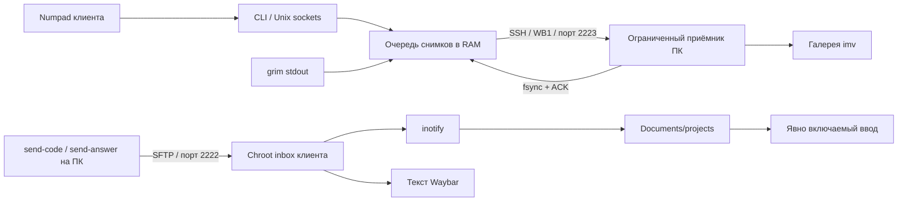

# Waybridge 0.2

Двусторонний обмен файлами и снимками экрана между двумя собственными Linux-компьютерами через Tailscale. Клиент работает в Hyprland/Wayland; второй компьютер принимает изображения в одну галерею и отправляет файлы клиенту через ограниченный SFTP.

Проект содержит полный код, установщик пользовательских компонентов, генератор проверяемого системного установщика, автоматические тесты и CI. Python-зависимости отсутствуют: используется стандартная библиотека. Виртуальное окружение создаётся без pip и без скачивания пакетов Python.

**Статус:** рабочая реализация, проверенная на конкретной паре CachyOS/Hyprland. Это не обещание безотказности на любом оборудовании или незаметности для стороннего ПО. Физические клавиши, процессы, виртуальная клавиатура и изображение на экране могут наблюдаться на системном уровне. Маскировка процессов, обфускация и динамическая смена хешей не реализованы. Сборки имеют постоянную версию и проверяемые контрольные суммы.

## Что изменилось

- Управление перенесено на физические клавиши Numpad без Super/Alt и без открытия интерфейса управления.
- Опционально поддерживается удержание 400 или 800 мс; аварийная остановка всегда немедленная.
- Снимки получают стабильный ID и SHA-256. Подтверждение отправляется после записи и синхронизации файла и каталога.
- При потерянном подтверждении повторная отправка того же ID не создаёт второй файл, пока исходный файл сохранён в галерее.
- Очередь ограничена количеством и объёмом данных; файлы снимков на клиенте не создаются.
- Для ввода и очереди используются `Type=notify`, watchdog systemd и ограничение частоты перезапуска.
- Перезапуск ввода всегда начинается с OFF. При потере фокуса, ошибке API или слишком медленной обработке ввод выключается.
- Файлы сохраняют имя отправителя, например `main.py`, и появляются в `~/Documents/projects`.
- Изменение времени касается только текста Waybar; системные часы не меняются.

## Архитектура



### Разделение привилегий

Оба SSH-сервера являются отдельными экземплярами `sshd`. Основной `/etc/ssh/sshd_config` не меняется.

На клиенте порт 2222 привязан к собственному Tailscale IPv4. Он допускает пользователя `bridge`, только ключевую аутентификацию и только `internal-sftp` внутри `/srv/bridge`. Shell, TTY и forwarding запрещены. На ПК порт 2223 принимает единственную принудительную команду приёма PNG от обычного пользователя.

Дополнительная таблица nftables отбрасывает обращения к соответствующему порту вне `tailscale0` и от любого IPv4, кроме настроенного второго компьютера. Ограничение источника дублируется в `authorized_keys`. Существующий firewall может дополнительно запрещать трафик; разрешать его в обход других правил установщик не пытается.

Доступ к клавиатуре предоставляется ACL только выбранному устройству ввода и одному UID. Пользовательские Python-процессы не запускаются от root. Root нужен для `sshd`, nftables, scoped ACL и демона `ydotoold`. Сокет ydotool принадлежит UID клиента; доступ всем пользователям к `/dev/uinput` не выдаётся.

Правило polkit разрешает указанному пользователю только `start`/`stop` двух системных units. Контроллер вызывает `StartUnit`/`StopUnit` по одному через D-Bus: это сохраняет конкретные поля `unit` и `verb` для проверки политики. Правило не даёт произвольного root-shell.

### Файлы

`send-code main.py` делает снимок содержимого исходного файла, передаёт его через SFTP под временным именем, затем переименовывает в исходное имя. Отправки сериализуются локальным `flock`. `put -f` использует расширение синхронизации OpenSSH SFTP.

На клиенте inotify устанавливается до начального сканирования. После рестарта уже имеющиеся файлы обрабатываются повторно. До обновления существующего файла его отличающееся содержимое сохраняется в `~/.cache/bridge/versions`. Последний успешно опубликованный файл, кроме JSON, записывается в `latest-code`.

Разрешённые расширения: `.py .cpp .c .h .hpp .rs .js .ts .java .go .sh .txt .json`. Имена состоят из ASCII букв, цифр, точки, дефиса и подчёркивания, максимум 101 символ; первый символ — буква или цифра. Вложенные пути не принимаются. Входящие symlink, FIFO и устройства не копируются. Файлы не выполняются автоматически. Максимальный размер — 32 MiB.

`clock.txt`, `clock.json`, `answer.txt` зарезервированы для вывода. Они не становятся файлом для ввода кода. У входящих текстовых ответов нет автоматической «невидимости» при захвате экрана.

### Снимки

Один поток захватывает PNG активного монитора через `grim -o MONITOR -`, второй последовательно отправляет кадры через SSH. PNG находится в памяти клиента. Буфер обмена не используется. Захват определяется в момент обработки запроса, а не обязательно в момент нажатия клавиши: при большой очереди это существенно.

По умолчанию в очереди максимум 8 запросов и 64 MiB PNG. Один PNG — максимум 32 MiB. SSH выполняется с таймаутом 30 секунд, не более трёх попыток для одного кадра. После исчерпания попыток кадр удаляется из RAM, в журнале появляется `delivery failed id=...`. Нет бесконечной очереди или бесконечных повторов.

Протокол `WB1`: префикс, однострочный JSON с `id`, `sha256`, `size`, затем ровно `size` байт PNG. Приёмник проверяет поля, размер, SHA-256, структуру PNG, размеры изображения и CRC chunks. Ответ содержит тот же ID, хеш, размер и `ok: true`. ACK означает запись файла, а не гарантированное появление окна галереи.

Приёмник совместим с прежним потоком чистого PNG. Новый отправитель требует новый ACK; поэтому при обновлении **сначала обновляют приёмник**. ПК сохраняет последние 50 кадров. Дедупликация действует пока файл этого ID не удалён; после удаления старого кадра глобальной истории ID нет.

В галерее используются один `imv-wayland` и IPC `imv-msg`. Стрелки переключают изображения. Клавиши `j`/`k` не документируются как переключение: в стандартной конфигурации imv они относятся к перемещению изображения.

### Ручной ввод

Ввод требует отдельного включения. На включении фиксируются содержимое последнего файла и адрес активного окна Hyprland. Замена содержимого файла во время ввода не меняет уже загруженный снимок кода.

Состояния: `OFF → ARMING → ACTIVE → OFF`. ARMING ждёт отпускания всех клавиш до пяти секунд. Только затем включается `EVIOCGRAB`. Автоповтор физических клавиш игнорируется. Каждое обычное физическое нажатие вводит один следующий символ. Перевод строки выдаётся **только по физическому Enter**, когда следующим символом файла является перевод строки. Ранний Enter игнорируется. Backspace удаляет предыдущий символ и возвращает позицию назад. После конца файла дополнительные печатные нажатия подавляются до выключения режима.

Escape выключает замену. Ctrl/Alt/Super переводят режим в выход и освобождают захват после отпускания комбинации. Numpad продолжает выполнять управляющие действия во время захвата встроенной клавиатуры. Если Numpad — отдельное USB-устройство, его привязки обслуживает Hyprland, поскольку захватывается только настроенная клавиатура ввода.

Принимается до 100000 ASCII-символов; табуляции разворачиваются в четыре пробела. Unicode не поддерживается. Раскладка виртуального устройства — US. Это не изменение физической раскладки пользователя.

Проверяется **окно Hyprland**, не DOM-поле, положение курсора или активная вкладка браузера. Переход в другое поле внутри того же окна не обнаруживается. Автоотступы, автоскобки и форматирование браузерного редактора нужно отключить в самом редакторе. Проект не обещает одинаковое поведение во всех веб-редакторах.

## Управление

| Физическая клавиша Numpad | Действие | Evdev | XKB code |
|---|---|---:|---:|
| 7 | Запустить транспорт и сервисы; ввод OFF | 71 | 79 |
| 8 | Добавить снимок в очередь | 72 | 80 |
| 9 | Полная аварийная остановка | 73 | 81 |
| 4 | Включить/выключить замену физических клавиш | 75 | 83 |
| 5 | Сбросить отображение к настоящему времени | 76 | 84 |
| 6 | Переключить показ числового ответа | 77 | 85 |

Системные привязки используют физические keycodes; NumLock не должен менять назначение. В профиле 0.2 нет прежних сочетаний Super/Alt для Bridge. Привязки других программ не удаляются. Numpad 7/8/9/4/5/6 резервируются; обычный ввод этих цифр через данный блок при активном модуле будет недоступен.

### Три варианта управления и их границы

1. **Прямой Numpad — основной профиль.** Не открывает окна и не требует модификаторов. Из доступных вариантов он создаёт меньше движений мыши и операций с фокусом. Это эргономическое преимущество, не гарантия отсутствия событий в логгере.
2. **Удержание Numpad на 400/800 мс — реализованный дополнительный профиль.** Снижает случайные срабатывания. Требует более длинного физического действия, поэтому не является универсально менее заметным. Аварийная 9 работает сразу.
3. **Команды с телефона через отдельно разрешённый SSH — возможная внешняя интеграция.** Не требует локального сочетания клавиш, но оставляет сетевую сессию и требует телефона. Клиентский SFTP-порт не предоставляет shell, поэтому такой доступ нужно настраивать отдельно; проект не включает скрытый HTTP-сервер или «invisible» страницу.

Клики в неактивные зоны не выбраны: события мыши, движение курсора и возможная смена фокуса делают поведение менее надёжным. Ни один из перечисленных вариантов нельзя честно назвать гарантированно недоступным стандартным или системным логгерам.

## Fail-safe и восстановление

| Событие | Поведение |
|---|---|
| Потеря адреса активного окна | Замена клавиш OFF, захват освобождается |
| Ошибка/таймаут `hyprctl` | Замена OFF; автоматического включения нет |
| Пауза цикла > 750 мс по умолчанию | Замена OFF, накопленные события сбрасываются |
| Ошибка ydotool | OFF, попытка отпустить все используемые виртуальные клавиши |
| Зависание основного цикла | Watchdog systemd, завершение процесса, рестарт с OFF |
| Завершение рабочего потока снимков | Процесс очереди завершается; systemd перезапускает его |
| Потеря сети | Ограниченные повторные попытки с тем же ID |
| Переполнение RAM-бюджета | Новый запрос/кадр отклоняется; очередь не растёт бесконечно |
| Ошибка inotify | Watcher завершается, systemd запускает его заново со сканированием inbox |
| Аварийная Numpad 9 | Marker stopped, OFF, остановка user units и root endpoints, сброс Waybar |
| Повторные постоянные сбои | После трёх запусков за минуту дальнейшие рестарты ограничены |
| Смена SSH host key | Соединение отклоняется, проверка ключа не отключается |
| Выключение питания/SIGKILL | Очередь в RAM теряется; уже принятые файлы остаются на ПК |

`WatchdogSec=4` обслуживается основным циклом процессов. Короткие вызовы API имеют отдельные таймауты. `WatchdogSignal=SIGKILL` исключает создание core dump при watchdog-срабатывании; `LimitCORE=0` дополнительно ограничивает core dumps. Это не управление swap или снимками памяти ОС. `KillMode=control-group` завершает дочерние SSH/grim-процессы вместе с сервисом. Ограничение `MemoryMax=384M` дополнительно сдерживает память процесса и его дочерних задач; 64 MiB относится только к PNG в бюджете, не ко всей памяти Python и копиям протокола.

Проект не измеряет универсальный FPS рабочего стола: для безопасности ввода используется задержка цикла и доступность API. Для «детекта процесса системой прокторинга» нет универсального события/API; нельзя реализовать достоверное автоматическое восстановление на основании несуществующего сигнала. Обфускация и смена хешей усложнили бы проверку и обновления, не обеспечив скрытие от наблюдателя с доступом к ОС.

**Аварийная остановка не завершает Tailscale, не удаляет доставленный код или изображения на ПК и не стирает журналы.** Сбрасывается только очередь клиента и активность Bridge. После остановки повторный логин сохраняет stopped; запуск явный. После обычного выхода без stopped модуль запускает Bridge при следующем входе, но замена клавиш остаётся OFF.

## Требования

- Два компьютера Linux; проверенная конфигурация — CachyOS/Arch, x86_64, systemd, Hyprland с Lua API 0.56, Wayland.
- Python 3.11+ (`tomllib` входит в стандартную библиотеку).
- Работающий Tailscale на обоих компьютерах, стабильные IPv4 сети 100.64.0.0/10, разрешённые соединения между ними.
- Клиент: `openssh nftables acl ydotool inotify-tools grim waybar`.
- ПК: `openssh nftables inotify-tools imv`.
- Активная пользовательская графическая сессия и `XDG_RUNTIME_DIR`.
- Достаточно места на ПК и в projects/history; очистка истории версий не автоматизирована.
- Numpad и доступ к выбранной клавиатуре ввода.

Публичный IP, IPv6 и port forwarding роутера не нужны. Доступность обоих peers через Tailscale не отменяет его ACL. До установки проверьте `tailscale status` и `tailscale ping`.

## Развёртывание с нуля

### 1. Установить системные зависимости

На клиенте:

```bash
sudo pacman -S --needed python openssh nftables acl ydotool inotify-tools grim waybar
```

На ПК:

```bash
sudo pacman -S --needed python openssh nftables inotify-tools imv
```

Tailscale должен быть установлен и авторизован заранее. Системный установщик повторяет только необходимую установку пакетов через pacman. Он не загружает исполняемые файлы с произвольных сайтов.

### 2. Проверить исходники и создать окружение

На каждом устройстве откройте каталог полученного репозитория:

```bash
PYTHONPATH=src python3 -m unittest discover -s tests -v
python3 -W error -m compileall -q src
python3 scripts/bootstrap.py --prefix "$HOME/.local/share/waybridge/venv"
export PATH="$HOME/.local/share/waybridge/venv/bin:$HOME/.local/bin:$PATH"
waybridge --help
```

Bootstrap вызывает `venv.EnvBuilder(with_pip=False)` и копирует полный пакет в site-packages этого окружения. Activation не требуется. На Arch отсутствие системного pip не мешает этому способу установки. При желании стандартная установка проекта возможна через `python -m pip install .` в отдельном venv; она требует setuptools, в отличие от offline bootstrap. Механизм виртуальных окружений описан в [Python venv](https://docs.python.org/3/library/venv.html).

### 3. Создать локальные конфигурации

На клиенте введите IPv4 ПК и его реальное имя пользователя:

```bash
read -r -p 'Tailscale IPv4 ПК: ' peer_ip
read -r -p 'Linux-пользователь ПК: ' helper_account
waybridge init --role client --peer-ip "$peer_ip" --helper-user "$helper_account"
```

На ПК введите IPv4 клиента:

```bash
read -r -p 'Tailscale IPv4 клиента: ' peer_ip
waybridge init --role helper --peer-ip "$peer_ip"
```

Собственный IPv4 берётся из `tailscale ip -4`, UID и пользователь — из текущего процесса. Конфигурация сохраняется в `~/.config/waybridge/config.toml` с mode 0600. Если она существует, `init` не перезаписывает её. Для изменений отредактируйте файл явно.

Клиент генерирует `~/.ssh/bridge-shot`, ПК — `~/.ssh/bridge-inbox`, только если ключа ещё нет. Используются Ed25519. Эти ключи ограничены forced command/chroot и адресом peer. Закрытые ключи остаются на своих устройствах.

Основные значения TOML:

| Поле | Значение по умолчанию / назначение |
|---|---|
| `role` | client/helper |
| `own_ip`, `peer_ip` | Проверенные Tailscale IPv4 |
| `user`, `helper_user` | Локальный пользователь и пользователь ПК |
| `inbox` | `/srv/bridge/inbox`; root installer требует этот путь |
| `projects` | `~/Documents/projects` |
| `state` | `~/.cache/bridge` |
| `keyboard` | `/dev/input/by-path/platform-i8042-serio-0-event-kbd` |
| `queue_count` | 8, допустимо 1–16 |
| `queue_bytes` | 67108864, допустимо 1–256 MiB |
| `png_limit` | 33554432, допустимо 1–32 MiB |
| `api_timeout` | 0.3 секунды, допустимо 0.05–0.5 |
| `loop_limit` | 0.75 секунды, допустимо 0.25–2 |
| `hold_ms` | 0; также допустимо 400/800 |

Пути должны быть абсолютными. Нестандартную клавиатуру выберите по `ls -l /dev/input/by-id /dev/input/by-path`, затем проверьте `udevadm info --attribute-walk --name PATH`. Не давайте себе чтение всех `/dev/input/event*`.

### 4. Обменять только публичные ключи через доверенный канал

Через уже проверенный Tailscale SSH, Taildrop или физический носитель передайте:

- с клиента на ПК: `~/.ssh/bridge-shot.pub`;
- с ПК на клиент: `~/.ssh/bridge-inbox.pub`;
- с каждого устройства второму: `/etc/ssh/ssh_host_ed25519_key.pub`.

Если host key ещё отсутствует, выполните на соответствующем устройстве `sudo ssh-keygen -A`.

Сохраните полученные ключи вне репозитория в `~/.config/waybridge/peer-auth.pub` и `~/.config/waybridge/peer-host.pub`. Это точные пути входных файлов следующих команд, не строки, которые нужно вставлять в исходный код.

Сравните fingerprint host key с выводом `ssh-keygen -lf /etc/ssh/ssh_host_ed25519_key.pub` на самом втором устройстве. Один `ssh-keyscan` без независимой проверки не является проверкой личности сервера. Никогда не передавайте файл без суффикса `.pub`.

На каждом устройстве:

```bash
waybridge link --peer-host-key "$HOME/.config/waybridge/peer-host.pub"
```

Команда создаёт отдельный pinned known_hosts и SSH alias. Клиент использует `bridge-shot`, ПК — `bridge-inbox`. Existing `bridge.conf` сохраняется в резервную копию; новый профиль выделен для Bridge. `StrictHostKeyChecking=yes`, `IdentitiesOnly=yes`, `BatchMode=yes`.

### 5. Подготовить и выполнить системный план

На каждом устройстве:

```bash
waybridge root-plan \
  --peer-key "$HOME/.config/waybridge/peer-auth.pub" \
  --output "$HOME/.config/waybridge/system-plan.sh"
bash -n "$HOME/.config/waybridge/system-plan.sh"
less "$HOME/.config/waybridge/system-plan.sh"
sudo bash "$HOME/.config/waybridge/system-plan.sh"
```

Это полностью сгенерированный Bash с фактическими адресами, ключом, UID и путями. В нём нет параметров-заглушек. Он проверяет IPv4 перед установкой, резервирует существующие конфиги в `/var/lib/waybridge/backups`, устанавливает отдельный sshd, nftables, ACL и политику управления.

На клиенте транспорт не включается автоматически при загрузке ОС. На ПК ограниченный приёмник стартует через системный unit. На обеих сторонах таблица фильтра включается как отдельный сервис. Если на ПК или клиенте уже работает другой сервис на 2222/2223, устраните конфликт до запуска.

Системный план привязан к конкретному компьютеру и не является частью публичного репозитория. Для переезда повторно сгенерируйте его из нового конфига.

### 6. Установить пользовательские компоненты

В графической сессии соответствующего пользователя на каждом устройстве:

```bash
waybridge install-user
waybridge doctor
```

User installer сохраняет заменяемые файлы в `~/.local/state/waybridge/backups/TIMESTAMP`, устанавливает units, wrappers и выполняет `systemctl --user daemon-reload`. Он ничего не включает и не захватывает клавиатуру.

`doctor` проверяет команды, XDG_RUNTIME_DIR и на клиенте читаемость клавиатуры/inbox. Это диагностика локальных предпосылок, не полноценный тест передачи или совместимости редактора.

В существующем `~/.config/hypr/hyprland.lua` клиента подключите модуль один раз:

```lua
dofile(os.getenv("HOME") .. "/.config/bridge/hypr-client.lua")
```

Затем:

```bash
hyprctl reload
hyprctl configerrors
```

Модуль использует внешний `exec_cmd`, чтобы не выполнять сеть и задержки внутри Lua event loop. Семантика bind и keycodes описана в [официальной документации Hyprland](https://wiki.hypr.land/Configuring/Basics/Binds/). Для старого Hyprland с hyprlang этот модуль не подходит.

### 7. Подключить Waybar

User installer создаёт `~/.config/bridge/waybar-modules.json`. Добавьте его через `include` в свой конфиг Waybar или перенесите два определения custom modules в существующий конфиг.

В `modules-center` замените `clock` на `custom/bridge-clock`; в `modules-right` замените `battery` на `custom/battery`. Не добавляйте второй экземпляр тех же модулей. Остальную раскладку панели сохраняйте.

Если нужен текстовый panel, unit `bridge-note.service` запускает отдельный Waybar. Установщик задаёт `overlay`, `passthrough` и `exclusive=false`; это влияет на размещение и клики, **не исключает panel из захвата монитора**. Он стартует вместе с клиентскими сервисами, поэтому текстовый файл `answer.txt` может быть отображён сразу после старта.

Поведение Screen Capture API зависит от выбранной поверхности: browser/window/monitor. Захват монитора не ограничивается содержимым браузера. Эти типы описаны в [MDN displaySurface](https://developer.mozilla.org/en-US/docs/Web/API/MediaTrackConstraints/displaySurface). Гарантированно невидимого Layer Shell здесь нет.

### 8. Первый запуск без ввода

На ПК в графической сессии:

```bash
systemctl --user import-environment WAYLAND_DISPLAY HYPRLAND_INSTANCE_SIGNATURE XDG_CURRENT_DESKTOP
systemctl --user start bridge-shot-view.service
```

На клиенте:

```bash
waybridge session-start
waybridge control start
waybridge control status
waybridge input status
```

Ожидается `input.mode: off`, активные root/user units, очередь пустая. `session-start` импортирует переменные графической сессии в пользовательский systemd. Без них grim/Hyprland/gallery могут не найти Wayland display. Если stopped отсутствует, session-start запускает Bridge; последующий явный start безопасно оставляет ввод OFF.

Проверьте один снимок через `waybridge shot request` и журнал `delivery confirmed`. Затем несколько нажатий Numpad 8. На ПК должны появиться разные кадры в одной галерее.

На ПК отправьте небольшой собственный файл:

```bash
printf 'print("ok")\n' > /tmp/waybridge-first-run.py
send-code /tmp/waybridge-first-run.py
send-answer 3 42
```

На клиенте файл должен появиться под именем `waybridge-first-run.py` в `~/Documents/projects`. Waybar может показывать `03:42`, но `date` продолжит возвращать настоящее время. Numpad 5 очищает значение; кнопки reset в панели нет.

Ввод сначала проверяйте в пустом локальном текстовом поле. Выключите автоскобки/отступы. Нажмите Numpad 4, отпустите все клавиши, набирайте вручную. Escape должен немедленно вернуть обычную клавиатуру. Затем отдельно проверьте Numpad 9 и повторный запуск Numpad 7. Физический тест особенно необходим для отдельного USB Numpad и выбранного устройства keyboard.

## Ежедневное использование

На ПК:

```bash
send-code "$HOME/Documents/projects/main.py"
send-code "$HOME/Documents/projects/solution.py" --name main.py
send-answer 7 9
```

На клиенте:

```bash
bridge start
bridge status
bridge stop
```

Wrappers вызывают установленный venv. Полный CLI остаётся доступным через абсолютный путь `~/.local/share/waybridge/venv/bin/waybridge`.

```bash
waybridge shot request
waybridge shot status
waybridge input status
waybridge input stop
waybridge clock reset
waybridge clock toggle
```

Отображение `07:09` — две цифры номера и две цифры ответа; оба значения 0–99. Это только формат числового ответа. Текстовая теория отправляется как `answer.txt`, её отображение не имеет гарантий исключения из screen capture.

Процент батареи читается из `/sys/class/power_supply/BAT*/capacity`. Слегка синий процент означает локальную готовность сервисов, online Tailscale peer и ответ SSH-banner ПК; слегка красный — отсутствие этой готовности. Проверка TCP выполняется раз в 15 секунд. Цвет не является подтверждением конкретной доставки, а процент всегда относится к реальной батарее. При отсутствии батареи выводится `АКБ —`.

### Профиль с удержанием

В `~/.config/waybridge/config.toml` задайте `hold_ms = 800` или 400. Затем в состоянии без активного ввода:

```bash
bridge stop
waybridge install-user
hyprctl reload
bridge start
```

Команды нажатия/отпускания проверяют monotonic время. Аварийная 9 по-прежнему выполняется на нажатии. Держать сам Numpad в режиме повтора не нужно.

## Проверка и диагностика

```bash
waybridge doctor
bridge status
journalctl --user -u bridge-key-code.service -u bridge-shot-queue.service -u bridge-files.service -n 100 --no-pager
systemctl --user show bridge-key-code.service -p MainPID -p NRestarts -p WatchdogUSec
systemctl status bridge-inbox.service ydotool-bridge.service --no-pager
```

На ПК:

```bash
systemctl status bridge-shot.service --no-pager
journalctl --user -u bridge-shot-view.service -n 50 --no-pager
```

### Частые проблемы

- **Host key changed:** остановитесь, сравните fingerprint через доверенный канал, обновите pin командой link. Не используйте `StrictHostKeyChecking=no`.
- **Permission denied publickey:** проверьте peer IP и root-owned authorized key. Публичный keyfile `/etc/bridge/keys/ACCOUNT` имеет mode 0644, чтобы sshd мог прочитать его при проверке пользователя; это публичный ключ.
- **Keyboard permission denied:** проверьте путь, ACL `getfacl`, совпадение выбранного устройства и udev rule. Не применяйте chmod 666 к uinput/event devices.
- **ydotool socket отсутствует:** проверьте системный unit и `/run/bridge-input/ydotool.sock`; пользовательские процессы используют явный YDOTOOL_SOCKET.
- **Wayland display не найден:** выполните import-environment из графической сессии, не из root shell.
- **Ввод сам выключается:** смотрите поле `reason`; причины включают фокус, API, lag. Не увеличивайте таймауты, пока не определена причина.
- **Сервис достиг лимита запусков:** устраните причину; `bridge start` делает reset-failed перед запуском.
- **Файл доставлен, но код не подходит:** ASCII-only, имя/расширение/размер и проекты проверяются отдельно. Входящий файл не выполняется.
- **Снимок не отображается, но ACK есть:** транспорт и галерея независимы. Проверьте user unit imv и WAYLAND_DISPLAY.
- **Очередь перестала отправлять:** посмотрите `delivery failed` и доступность pinned SSH. Очередь не хранит кадры на диске для следующего входа.

Журналы содержат ошибки, ID кадров и статусы; физические набранные символы не записываются. Для публичных issues предварительно удаляйте частные пути, адреса и содержимое данных.

## Обновление и откат

1. Остановите Bridge на клиенте (`bridge stop`).
2. Обновите пакет и root-owned receiver wrapper на ПК, сохранив backup. Приёмник 0.2 поддерживает старый чистый PNG.
3. Повторите bootstrap и install-user на клиенте.
4. Перезагрузите Hyprland config, проверьте configerrors, запустите Bridge с OFF.
5. Выполните тест передачи и аварийной остановки.

Bootstrap перезаписывает установленный пакет; не запускайте его во время активного ввода. User installer резервирует прежние scripts/configs/units, но не прежнюю копию site-packages: для полного отката потребуется исходный пакет предыдущей версии или прежние standalone scripts из backup.

Пользовательские резервные копии: `~/.local/state/waybridge/backups`. Системные: `/var/lib/waybridge/backups`. Восстановите нужные файлы из выбранной копии при остановленном Bridge, затем выполните `systemctl --user daemon-reload`, при изменении system units — `sudo systemctl daemon-reload`, и `hyprctl reload`. Не удаляйте пользователя `bridge`, firewall или группы, не проверив зависимости других программ.

Старые входящие файлы, history и gallery автоматически не удаляются. Они находятся вне репозитория и могут требовать ручной очистки.

## Разработка, тесты и публикация

```text
src/waybridge/
  cli.py          команды и диагностика
  config.py       валидированный TOML
  runtime.py      fsync, sockets, notify, bounded API
  install.py      user installer, root plan, host key pinning
  control.py      запуск/полная остановка с rollback запуска
  protocol.py     frame, PNG validation, ACK
  receiver.py     устойчивый приём и дедупликация
  screenshots.py  RAM FIFO и ограничения
  files.py        SFTP и inotify
  keyboard.py     физические нажатия и fail-closed состояния
  inject.py       ydotool emitter и отпускание клавиш
  display.py      clock/notes/battery Waybar
  gallery.py      imv IPC
scripts/bootstrap.py
scripts/release.py
tests/test_core.py
.github/workflows/tests.yml
SECURITY.md
LICENSE
```

Проверки без оборудования:

```bash
PYTHONPATH=src python3 -m unittest discover -s tests -v
python3 -W error -m compileall -q src
python3 scripts/bootstrap.py --prefix .venv
.venv/bin/waybridge --help
```

Тесты проверяют malformed protocol, CRC/хеш/размер, ACK, повтор и collision ID, Enter/Backspace/EOF, path boundaries, Unicode rejection, RAM budget, атомарную проекцию/backup, symlink rejection, TOML и профиль Numpad. Они не заменяют hardware-тест grab, клавиатуры и веб-редактора. CI выполняет тесты на Python 3.11/3.14, без настройки оборудования и root.

Подготовка исходного архива:

```bash
python3 scripts/release.py --output ../waybridge.tar.gz
sha256sum -c SHA256SUMS
```

Release script включает только перечисленные исходные каталоги, README, SECURITY, LICENSE, pyproject и .gitignore. Он не добавляет venv, локальные deployment configs, ключи, изображения или пользовательские данные. Порядок файлов и tar metadata фиксированы; gzip timestamp самого контейнера может отличаться. SHA256SUMS проверяет содержимое, но не подтверждает автора — для публичных релизов владельцу репозитория стоит отдельно подписывать релиз своим ключом.

`.gitignore` исключает venv, deployment, ключи и данные. До публикации всё равно проверьте staged diff: игнорирование не удаляет уже отслеживаемые файлы. Репозиторий не содержит настроенного remote и не публикуется автоматически. Подключение собственного GitHub remote и push — отдельный шаг владельца.

## Принцип надёжности

Приоритет — ограниченные ресурсы, явные состояния, проверяемая доставка, минимальные привилегии и понятная остановка. После сбоя ввод останавливается; сеть может восстановиться самостоятельно, но клавиатура не включается без явного действия пользователя. Документация не превращает этот инструмент в гарантию незаметности или совместимости с неизвестной системой наблюдения.
